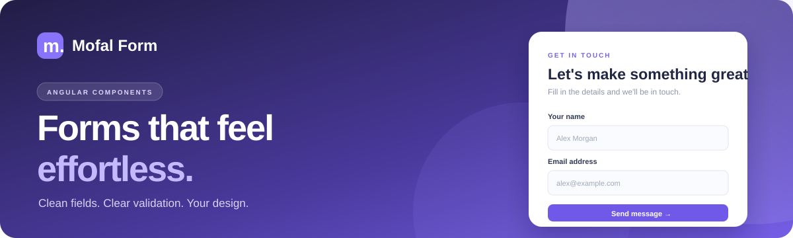

  

  
  
  

<strong>Clean fields. Clear validation. Your design.</strong>

Mofal Form is a small Angular component library for building polished forms. It includes a form surface, a field that works with Angular Forms, and a submit button. The repository also contains a demo app so you can see the components in context.

> **Status:** v0.1 starter release. The components and local demo build; the demo submit action is local only. This package has not been published to npm.

## Preview

## What's inside

| Component | Selector | Purpose |
| --- | --- | --- |
| `MfFormCardComponent` | `mf-form-card` | A heading and surface for form content |
| `MfFieldComponent` | `mf-field` | Input or textarea with labels, hints, errors, and `ControlValueAccessor` |
| `MfButtonComponent` | `mf-button` | Themed submit, reset, or regular button |

## Run the demo

Use Node.js 20.19+, 22.12+, or 24.0+ and npm. Angular 21's compatibility table lists the supported versions.

~~~bash
npm install
npm run build:lib
npm start
~~~

Open `http://localhost:4200`. The demo validates three fields and displays a local success state.

## Build a package file

~~~bash
npm run build:lib
cd dist/mofal-form
npm pack
~~~

This creates a `.tgz` file you can install in an Angular 21 project. The library is **not** published to npm, so `npm install mofal-form` is not currently a valid installation path.

## Use in an Angular app

After installing the generated `.tgz` and `@angular/forms`, import the standalone components:

~~~ts
import { Component } from '@angular/core';
import { ReactiveFormsModule, FormControl, FormGroup } from '@angular/forms';
import { MfButtonComponent, MfFieldComponent, MfFormCardComponent } from 'mofal-form';

@Component({
  selector: 'app-contact',
  standalone: true,
  imports: [ReactiveFormsModule, MfFormCardComponent, MfFieldComponent, MfButtonComponent],
  template: `
    <mf-form-card title="Get in touch" description="We would love to hear from you.">
      <form [formGroup]="form" (ngSubmit)="submit()">
        <mf-field name="email" label="Email" type="email"
          formControlName="email" [required]="true" />
        <mf-button>Send message</mf-button>
      </form>
    </mf-form-card>
  `,
})
export class ContactComponent {
  form = new FormGroup({
    email: new FormControl('', { nonNullable: true }),
  });

  submit() {
    console.log(this.form.value);
  }
}
~~~

Every `mf-field` needs a unique `name` on the page for its label and helper text to be associated with the control.

## Theme it

Set CSS custom properties on a parent element or globally:

~~~css
:root {
  --mf-accent: #7059e8;
  --mf-ink: #1d2540;
  --mf-muted: #73809a;
  --mf-surface: #ffffff;
  --mf-input-bg: #fafbff;
  --mf-border: #dfe3ee;
  --mf-radius: 24px;
  --mf-font: Inter, ui-sans-serif, system-ui, sans-serif;
}
~~~

See [component details](docs/components.md) for inputs and behavior.

## Project layout

~~~text
projects/
  mofal-form/     Angular library and public API
  demo/           Showcase app with a local form flow
docs/             Preview and component documentation
.github/workflows Continuous build
~~~

## Contributing

See [CONTRIBUTING.md](CONTRIBUTING.md). This project is available under the [MIT license](LICENSE).

