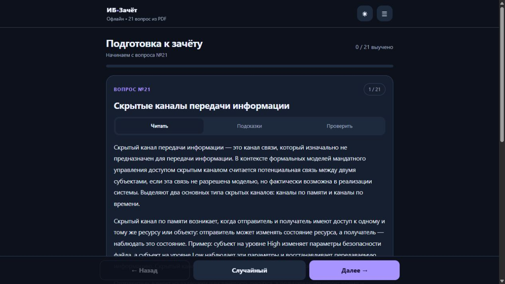

# Offline study form reference

[Open the standalone example](security-study.html) or download the file and open it in a browser. The page is a Russian-language information-security study interface with 21 questions, free-form recall notes, self-assessment controls, progress state, theme switching, and optional speech playback.

This example is included as a **form interaction reference**. It shows a longer user flow than the three-field contact form in the Angular demo: users read, write a response, reveal a reference answer, then record their own assessment. This page is plain HTML, CSS, and JavaScript. It does not use or document an Angular API.

## Mapping the patterns to Mofal Form

| Reference pattern | Angular implementation starting point |
| --- | --- |
| Recall notes textarea | `mf-field` with `[multiline]="true"` and a form control |
| Text input feedback | `mf-field` with `hint` or `error` |
| Primary action | `mf-button` inside a form |
| Grouped content | `mf-form-card` with projected controls |
| Progress, speech, local storage, and navigation | Application code outside the library |

The page makes no calls to third-party services. It stores notes, marks, and theme selection in the browser's local storage under `ib_zachet_v1`. Speech playback depends on the browser and installed voices. When served over HTTPS or localhost, its adjacent `sw.js` caches the page after a successful visit; opening the HTML directly also works without a service worker.

The study content came from the supplied reference file. This repository does not include the source PDF, so the example is not presented as a verified security textbook.

